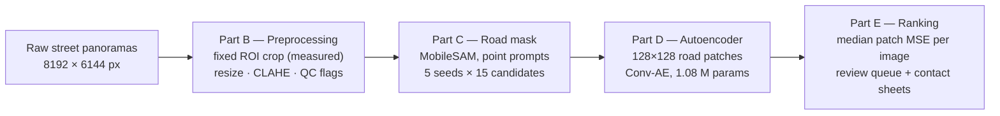
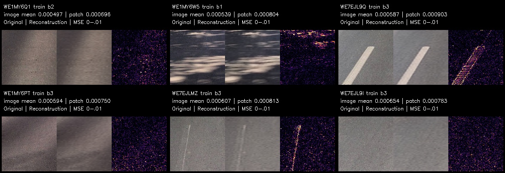
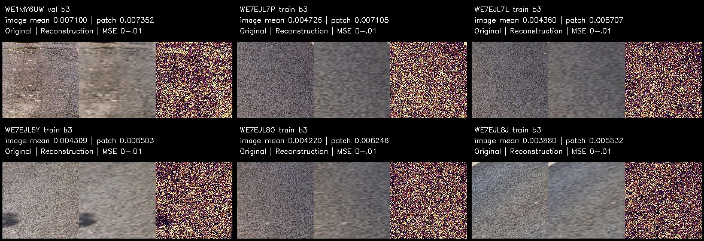

# road-anomaly-detection

**Unsupervised road-surface anomaly detection on street-level panoramas.**

The pipeline learns what *normal* road looks like — and flags what doesn't fit.
No damage labels are used anywhere: a promptable segmenter isolates the road
surface, a convolutional autoencoder is trained only on road patches, and
per-image reconstruction error becomes a ranked review signal.


## Pipeline



- **B — Preprocessing.** A *measured* fixed ROI band (40–80 % of frame height)
  removes sky and hood deterministically; CLAHE mitigates shadows; robust-z
  outliers (hood/board intrusions) land in `flags.csv` — "flag, don't fix".
  B also owns the separate, unenhanced RGB view that C consumes.
- **C — Road segmentation.** MobileSAM with a handful of positive/negative
  point prompts; 5 seeds × 15 mask candidates per image, ranked by an explicit
  heuristic (anchor hits, corridor coverage, asphalt color, vegetation
  rejection), then cleaned (largest component + opening) and eroded for D.
- **D — Autoencoder.** ≤ 24 patches per image (128 × 128, 4 depth bands,
  perspective-aware), spatial split by 300 m cells with a 30 m buffer and
  SHA-256 duplicate grouping **before** patch sampling — no train/val leakage.
  Denoising Conv-AE (1,078,307 parameters, no skips), input noise σ = 0.02,
  early stopping, deterministic seeds.
- **E — Anomaly ranking.** Median patch MSE per image (robust against
  single-patch outliers), low-support flagging for images with < 4 usable
  patches, ranked CSVs and visual contact sheets for manual review.

## Results

Three documented runs (all trained on CPU; full numbers and figures in
[`docs/results/README.md`](docs/results/README.md)):

| Run | Images | Patches (train/val/buffer) | Best epoch | Val MSE |
|---|---|---|---|---|
| Stage 1 — mini dry run | 108 | 672 / 282 / 42 | 30 | 0.003609 |
| Stage 2 — pool subset | 1,765 | 10,683 / 3,833 / 639 | 29 | 0.001829 |
| Full pool | 12,432 | 80,678 / 23,909 / 4,828 | 29 | 0.000905 |

The full-pool model scores 12,017 images; the 99th percentile of the ranking
sits at 7.2× the median reconstruction error, i.e. the tail is well separated.
Typical vs. most-anomalous images:

| Most typical | Most anomalous |
|---|---|
|  |  |

**Interpretation:** the signal is *visual unusualness*, not a damage
probability — every ranked image goes to a review queue with per-patch error
heatmaps, original/reconstruction side-by-sides and an editable
`manual_review.csv`.

## Quickstart

```bash
git clone https://github.com/Streeti04/road-anomaly-detection.git
cd road-anomaly-detection

python3.12 -m venv .venv
.venv/bin/pip install -r requirements.txt

# model weights (MobileSAM), SHA-256-pinned, ~40 MB
.venv/bin/python -m aibip.fetch_models

# put your panoramas + metadata under data/ (see "Data" below), then:
.venv/bin/python -m aibip.pool inventory --images "data/my_panoramas" --metadata data/my_metadata.json
.venv/bin/python -m aibip.pool segment  --images "data/my_panoramas" --metadata data/my_metadata.json
.venv/bin/python -m aibip.pool extract  --images "data/my_panoramas" --metadata data/my_metadata.json
.venv/bin/python -m aibip.pool train
.venv/bin/python -m aibip.pool analyze
```

On macOS/zsh the whole chain (tests → segmentation → extraction → training →
analysis) is one command:

```bash
./train.sh                     # SKIP_SEGMENT=1 / RESUME=1 / EPOCHS=10 ./train.sh
```

Tests (103, synthetic data only, no model download):

```bash
.venv/bin/pytest -q
```

## How a fresh clone works

`aibip.pool` is the entry point designed for fresh checkouts: it needs **no**
mini-set, no cached masks and no results from earlier runs — just your image
folder and a metadata JSON. Step-by-step, including Windows/PowerShell:
[`Anleitung.md`](Anleitung.md) (German).

## Notebooks

Step-by-step, cell-by-cell walkthroughs of the three stages
(outputs cleared; they regenerate against `data/mini/`):

- [`notebooks/part_b_step_by_step.ipynb`](notebooks/part_b_step_by_step.ipynb) — ROI crop, CLAHE, QC flags
- [`notebooks/part_c_step_by_step.ipynb`](notebooks/part_c_step_by_step.ipynb) — prompts, SAM candidates, mask selection
- [`notebooks/part_d_step_by_step.ipynb`](notebooks/part_d_step_by_step.ipynb) — patch extraction, training, reconstruction

## Repository tour

```
aibip/
  config.py          constants only: paths, ROI, patch/training parameters
  imgio.py           BGR-first image I/O helpers
  stats.py           robust median/MAD outlier flagging (torch-free)
  part_b.py          preprocessing: ROI, resize, CLAHE, flags, figures
  c_test_core.py     SAM candidate scoring/selection heuristic
  c_transfer.py      raw-frame adapter: prompts, mask → work view
  part_c.py          segmentation CLI (run/benchmark/qc/single)
  d_data.py          patch extraction: audit, green filter, spatial split
  d_training.py      shared Conv-AE trainer (checkpoints, resume)
  part_d.py          mini CLI (extract/train/preview/compare)
  part_e.py          ranking + review queue (legacy entry)
  pool_data.py       pool input pipeline, no mini dependency
  pool.py            fresh-clone CLI: inventory→segment→extract→train→analyze
  d_pool.py          data adapter for the documented stage-2 run
  d_stage2.py        documented stage-2 CLI (reproduction)
  mini.py            deterministic 100-image mini set
  fetch_models.py    pinned weight download (SHA-256 verified)
  b_refactor_compat.py + registry.json   cache compatibility for the B/C move
tests/               103 pytest tests, 7 files, synthetic images only
docs/                architecture, report, written part-A answers (German)
docs/results/        metrics, learning curves, previews, rankings (3 runs)
```

## Documentation (German)

- [`docs/ARCHITEKTUR.md`](docs/ARCHITEKTUR.md) — module graph, CLI table, data flow, design rationale
- [`docs/report.md`](docs/report.md) — full results report with limitations
- [`docs/part_a_answers.md`](docs/part_a_answers.md) — written conceptual foundations (A.1–A.5)
- [`Anleitung.md`](Anleitung.md) — reproduction guide for your own images

## Limitations

- Reconstruction error is an *anomaly signal*, not a damage class — rankings
  need human review (the pipeline generates the review material for it).
  The best model literally encodes "average road"; damage that looks like
  average road stays invisible.
- Confounders (lane markings, vegetation, shadows) are filtered heuristically;
  the green filter and confounder labels trade recall for train-set purity.
- Training is CPU-friendly but not fast: the 15k-patch subset took ~4 h
  (30 epochs) on a laptop CPU; the full pool ran overnight.
- Segmentation quality depends on prompt placement; the fixed prompt profile
  is tuned for the capture geometry of one vehicle/campaign and may need
  adjustment for other framing regimes.

## License

[MIT](LICENSE) © 2026 Streeti04
