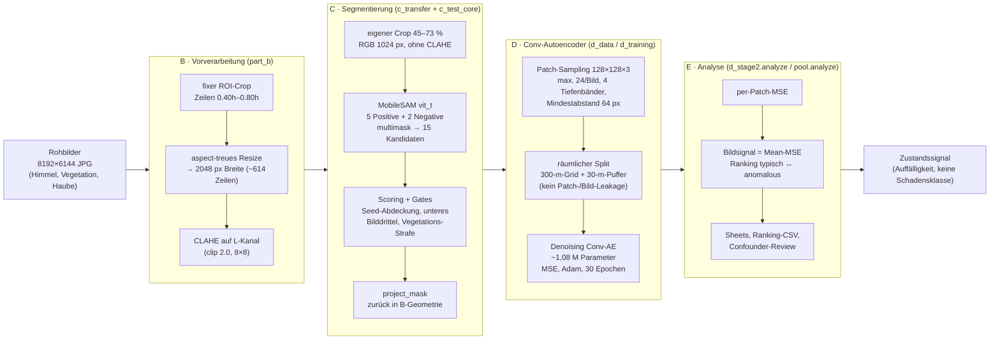
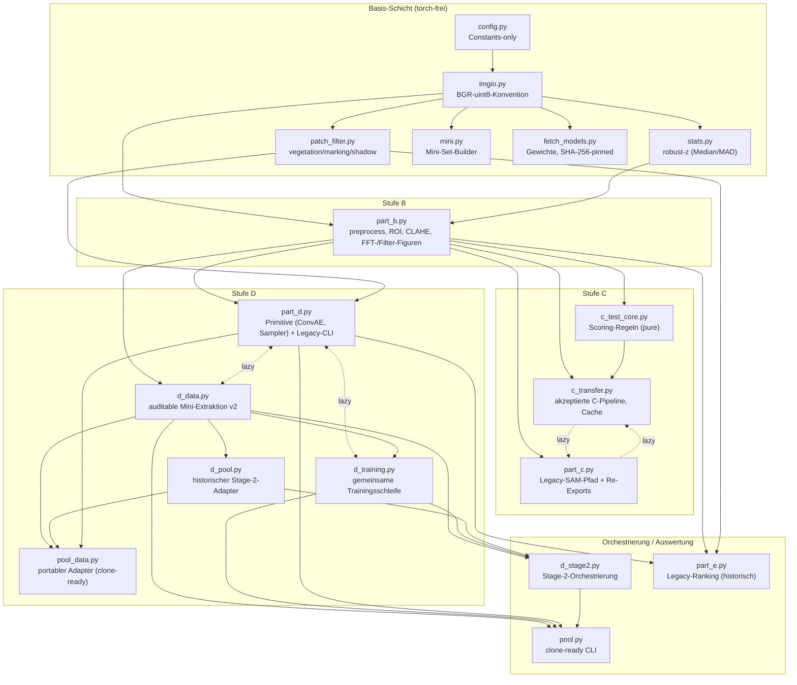
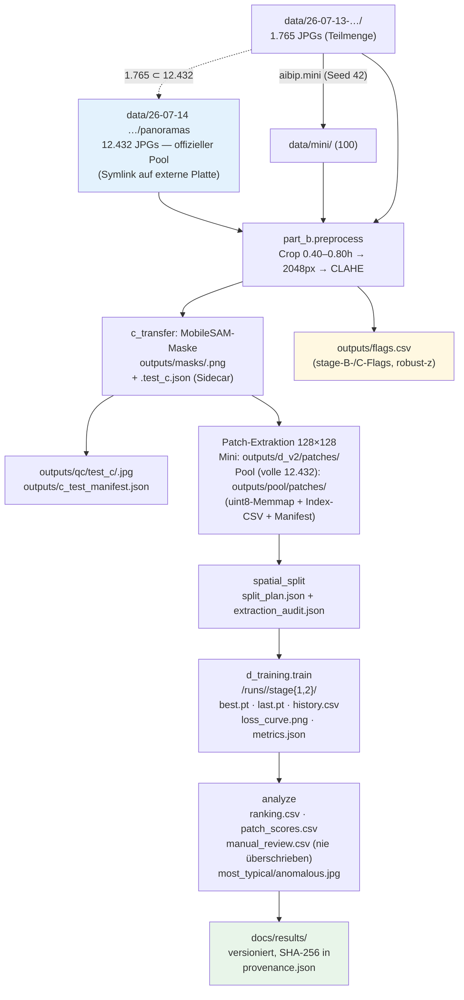
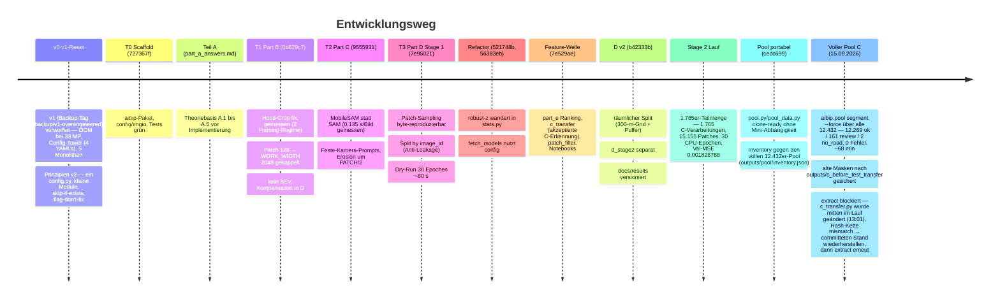

# Architektur- und Design-Dokumentation

**Stand:** fertiggestellter Projektstand (12.09.2026); aktualisiert **15.09.2026** (voller Pool-Lauf, Mini-Set-Klärung, Test-Nachprüfung) · **Umfang:** `aibip`-Paket (19 Module), 6 Testdateien, 96 Tests (lokal verifiziert: 92 grün)
Diese Datei beschreibt Architektur, Datenfluss, Design-Entscheidungen und den Abgleich mit der
Aufgabenstellung („A Road-Condition Analysis Pipeline from Unlabeled Street-Level Imagery“).
Sie ist reine Dokumentation — der Ergebnisüberblick für Kollegen steht in
[results/README.md](results/README.md), die Methodik in [report.md](report.md), die Reproduktion
in [../Anleitung.md](../Anleitung.md).

---

## 1. Kontext und Ziel

Im ISBI-Forschungsprojekt soll die Zustandserfassung von Straßen (ZEB/E-EMI-Kontext) automatisiert
werden. Die Aufgabe: aus **ungelabelten** Cyclomedia-Straßenaufnahmen eine quantitative,
bildweise **Straßenzustands-Signalgröße** ableiten — ohne ein einziges Label:

> **(B)** klassische Vorverarbeitung → **(C)** promptbare Segmentierung der Fahrbahn →
> **(D)** generatives Modell (Conv-Autoencoder), trainiert nur auf extrahierten Straßen-Patches →
> **(E)** Rekonstruktionsfehler als Anomalie-Signal, gerankt und qualitativ geprüft.

**Wichtigste Grundregel der Aufgabe:** Kein Reward-Signal, keine Ground Truth anywhere — jede
Design-Entscheidung muss aus ersten Prinzipien begründet und visuell/qualitativ validiert werden.
Der Rekonstruktionsfehler ist deshalb ausdrücklich **keine Schadensklasse**, sondern ein
*visuelle-Auffälligkeit*-Signal (Confounder möglich: Schatten, Markierungen, Textur).

**Datenlage (real, gemessen — Stand dieser Doku):**

| Bestand | Wert | Anmerkung |
|---|---|---|
| **Voller Pool (offizieller Stage-2-Pool)** | **12.432 JPGs** | `data/26-07-14 Cyclomedia-Test-Hammersbach/panoramas/`; `data` ist ein Symlink auf die externe Platte (~87 GB Rohdaten) |
| Metadaten | 12.432 Einträge | `recordings_bbox_complete.json` — **ID-Volldeckung** mit dem Pool; GPS/Geometrie je Aufnahme, Pflichtargument in `aibip.pool` |
| Mini-Quelle | 1.765 JPGs | `data/26-07-13-Cyclomedia-Test-Hammersbach` — **vollständige Teilmenge des Pools** (Stem-Vergleich: 1.765 ⊂ 12.432, 0 fehlend) |
| Offizielles Mini-Set | 100 Bilder | `N_MINI=100`; `data/mini/` = **exakt** das kanonische `make_mini(n=100, seed=42)`-Sample der aktuellen Quelle (durch Neuberechnung verifiziert). Die dokumentierten Läufe nutzten eine **108er-Variante**: diese 100 + 8 manuell hinzugekommene Bilder (`WE1MY5SK`, `SM`, `SN`, `SO`, `SP`, `SQ`, `SR`, `SS` — fortlaufende IDs, in Quelle/Pool vorhanden). Die 108er-Variante ist per `mini.py` nicht reproduzierbar und existiert auf der Platte nicht mehr |

Der in der Aufgabe genannte ~10.000er-Pool ist damit real vorhanden und wird für das **volle
Training** verwendet: `aibip.pool inventory` wurde gegen den Panorama-Pool gefahren
(`outputs/pool/inventory.json`: 12.432 Bilder, 12.432 Metadaten-IDs, CUDA=false; rekursive
Suche ohne Mini-Abhängigkeit). Der **dokumentierte** Stage-2-Lauf nutzte jedoch nur
die 1.765er-Teilmenge — die Results-Angabe „10.667 Metadaten-IDs ohne Bilddatei" bezog sich auf
den 26-07-13-Ordner, nicht auf den Panorama-Pool. Alle Stage-2-Kennzahlen in §6 beziehen sich
daher auf die Teilmenge; das volle Training auf allen 12.432 Bildern läuft über `aibip.pool`
(siehe [../Anleitung.md](../Anleitung.md)). Konsequenz der Mini-Erkenntnis: Mini-Bezüge in
report/results („108 Bilder, 996 Patches") beschreiben die historische 108er-Variante; eine
Erneuerung der Mini-Auswertung auf dem heutigen `data/mini` würde 100 Bilder ranken und leicht
anders ausfallen.

---

## 2. Architekturüberblick

### 2.1 Pipeline (Fachebene)

Jede Stufe verkleinert das Problem für die nächste: B entfernt Nie-Straße (Himmel, Haube),
C isoliert die Fahrbahn präzise, D lernt nur *normale* Fahrbahnoptik — schlecht Rekonstruiertes
ist Kandidat für „visuell ungewöhnlich".

### 2.2 Modulabhängigkeitsgraph

Pfeile = „importiert". Zwei Zirkularitäten (`part_c ⇄ c_transfer`, `part_d ⇄ d_data/d_training`)
sind per **Lazy-Import** aufgelöst (Torch/mobile_sam werden erst in Funktionen geladen —
dadurch laufen `import aibip.part_c` und die Unit-Tests ohne Torch-Installation).

**Koexistenz alter und neuer Pfade (bewusst, Reproduzierbarkeit):**

| Modul | Rolle | Status |
|---|---|---|
| `part_b`, `c_transfer` (+`c_test_core`) | aktive Stufen B und C | **aktiv** |
| `d_data` + `d_training` | Mini-Extraktion v2 + gemeinsamer Trainer | **aktiv** |
| `d_pool` + `d_stage2` | historischer Stage-2-Lauf (dokumentierter Run) | aktiv für Nachvollzug |
| `pool_data` + `pool` | clone-ready Einstieg **ohne** Mini-Abhängigkeit | **aktiv**, neuer Einstieg (`Anleitung.md`) |
| `part_d._legacy_*`, `part_e` | Legacy-Pfade (`outputs/patches`, `outputs/runs`) | historisch; `part_e` **darf nicht** für Stage-2-Auswertung genutzt werden (README) |
| `fetch_models`, `mini` | Setup-Helfer | aktiv |

### 2.3 CLI-Einstiegspunkte

Alle Aufrufe erfolgen als `python -m aibip.<modul>`; Torch wird lazy geladen.

| Einstieg | Subcommands | Bemerkung |
|---|---|---|
| `aibip.pool` | `inventory`, `segment`, `extract`, `train`, `preview`, `analyze` | **Neuer Hauptweg**; `--images`/`--metadata` Pflicht; `--device auto` = CUDA→MPS→CPU |
| `aibip.d_stage2` | dieselben sechs | historischer dokumentierter Lauf |
| `aibip.part_d` / `aibip.d_training` | `extract`, `train`, `preview`, `compare` | Stage 1 (Mini, `outputs/d_v2`); `compare` = MSE vs. MSE+Edge |
| `aibip.part_c` | `run`, `benchmark`, `qc`, `single` | delegiert an `c_transfer` |
| `aibip.part_b` | `figures`, `preview` | B-Abbildungen, Vorverarbeitungs-Preview |
| `aibip.part_e` | `analyze`/`run`/`qc` | **Legacy**-Ranking, eigene Modell-/Patchpfade |
| `aibip.mini`, `aibip.fetch_models` | — | Setup ohne argparse |

### 2.4 Datenfluss und Artefakte

**Git-Strategie:** `data/`, `models/`, `outputs/` sind gitignored (große, regenerierbare Artefakte).
Nur `docs/results` (Abbildungen, Tabellen, `provenance.json` mit SHA-256 je Datei) ist versioniert —
Ergebnisse sind ohne Datensatz, Gewichte oder Training einsehbar. Der Stage-2-Checkpoint muss für
Abgabe/Inferenz **separat** bereitgestellt werden.

**Gewichte:** `fetch_models` lädt `models/mobile_sam_vit_t.pt` (40,7 MB) und
`models/segformer-b0-cityscapes.onnx` (15,2 MB), beide SHA-256-gepinnt, atomar, idempotent.
Das SegFormer-ONNX wird vom fertiggestellten Stand **nicht importiert** (gehört zum ungemergten
Hybrid-Branch, siehe §4.6).

---

## 3. Komponenten im Detail

### 3.1 Stufe B — `part_b.py`

- **`preprocess(image) -> image`** = `crop_roi` (Zeilen `[0.40h, 0.80h)`) → `resize_band`
  (aspect-treu auf `WORK_WIDTH=2048`, INTER_AREA, ~614 Zeilen) → `apply_clahe`
  (LAB-L-Kanal, clip 2.0, Tiles 8×8; Schalter `config.USE_CLAHE`).
- **Hood-Entfernung = fixer Crop, keine Detektion.** Gemessen statt geraten: zwei Framing-Regime
  im Mini-Set (Haubenkante 0,73–0,79h bzw. 0,86–0,94h); der Cut liegt bewusst *über* der sauberen
  Kante (0,73h worst case), um Nahfeld-Straße zu erhalten. Resteinstreuer werden nicht repariert,
  sondern **geflaggt** („flag, don't fix"): `hood_strip_stats` (HSV V/S im unteren Streifen) +
  `stats.outlier_flag_rows` → `flags.csv`.
- **Perspektive:** kein BEV-Warp (Begründung §4.3); Kompensation erfolgt in D über 4 Tiefenbänder.
- **Frequenz-/Filteranalyse** (dokumentarisch): `figure_fft` (log-Magnitudenspektrum),
  `figure_filters` (Gaussian 5×5 σ1.5, Sobel-Magnitude, Canny 50/150), CLAHE-A/B-Figur,
  ROI-Beispielfiguren → `docs/assets` bzw. `outputs/`.

### 3.2 Stufe C — `c_transfer.py` + `c_test_core.py`

Akzeptierte Pipeline (`VERSION='test-road-c-1'`, Backend `mobile_sam`, Gewichte `vit_t`):

1. Eigener Crop 45–73 % der Rohhöhe, RGB, 1024 px Breite, **ohne** CLAHE (Gewichtsgründe: das
   Testprojekt-Modell wurde so akzeptiert; B-CLAHE würde die Verteilung verschieben).
2. `TestRoadSegmenter.predict`: **5 Positive** (x ∈ {0,20 … 0,80}, y=0,92h — getrennte Seeds
   erlauben Kurven) + bis zu **2 Negative** (nächstgelegene grüne Pixel) × `multimask` → **15 Kandidaten**.
3. Je Kandidat: größte Seed-enthaltende Komponente, `candidate_score` = confidence + 0,65·Seed-Abdeckung
   + 0,25·bottom_center + 0,35·bottom_any − 2,5·Vegetation − 1,2·Textur(Canny) − 0,6·Sättigung.
   Gates: Area [0,02; 0,95]; score < 0,5 oder vegetation > 0,45 → `no_road`; sonst `review`
   bei Konfidenz < 0,85 oder vegetation > 0,12; sonst `ok`.
4. `project_mask` zurück in die B-Work-Geometrie (nearest, exakte Koordinatenkette, außerhalb = 0).

**Cache/Integrität:** `cache_key = sha256(Bild) ⊕ sha256(Settings ∥ Gewichte-Hash ∥ Code-Hashes)`.
Quell-, Gewichts- oder Codeänderungen invalidieren nicht still, sondern brechen mit Aufforderung
`--force` ab (Backup vor Ersetzen). Preflight hasht **alle** Bilder vor der ersten Maskenänderung;
Bildfehler werden gesammelt und am Ende als `RuntimeError` gemeldet. Nachgelagert prüfen die
D-Adapter die Sidecars (Status, Hash-Kette), bevor Patches entstehen.

Der Legacy-Pfad in `part_c` (Centerline-Prompts, lexikographische Auswahl, `road_corridor`,
`expand_road_surface`) bleibt für Unit-Tests und Vergleich erhalten.

### 3.3 Stufe D — `d_data.py`, `d_training.py` (+ Primitive aus `part_d.py`)

- **Patch-Sampling:** 128×128×3, max. 24/Bild (`D_CAP_PER_IMAGE`), verteilt auf **4 Tiefenbänder**
  (Bandfläche-proportional, Largest-Remainder) über die Road-Zeilen; Kandidaten nur aus der
  erodierten Maske (`allowed_region`, Erosion 129×129 → kein Patch berührt den Maskenrand);
  Mindestabstand 64 px (`spaced_centers`); RNG pro Bild deterministisch:
  `default_rng(SEED XOR crc32(image_id))` — byte-reproduzierbar, per SHA-256 im Manifest belegt.
- **Räumlicher Split statt Zufalls-Split:** 300-m-Gridzellen, exakte Duplikate (SHA-256) über
  Zellgrenzen via Union-Find zusammengehalten, **30-m-Pufferzone** zwischen Train/Val (Pufferbilder
  zählen für keines). Begründung: benachbarte Aufnahmen sind beinahe identisch → zufälliger Split
  wäre Leakage und der Val-MSE geschönt.
- **Architektur** (`part_d._build_model`): Denoising Conv-AE, Encoder 4×(Conv 3×3, stride 2) mit
  32/64/128/256 → Bottleneck 8×8×256 → gespiegelter ConvTranspose-Decoder → Sigmoid;
  **1.078.307 Parameter**. Größe begründet gegen das Patch-Budget (~15k Patches Stage 2):
  groß genug für Textur, klein genug für Minuten-Trockenläufe und Stunden-Training auf CPU.
- **Training:** Loss = MSE (+ optional `edge_weight`·Gradient-L1); Denoising-σ=0,02;
  Adam lr 1e-3; ReduceLROnPlateau (0,5, patience 2); Early Stopping patience 5 auf `val_mse`;
  Grad-Clip 5 mit `error_if_nonfinite`; Seed überall 42, `cudnn.deterministic`; Resume persistiert
  RNG-States (getestet: Resume ≡ Dauerlauf bis auf Byte).
- **Device:** `device_for` = cpu/cuda/auto (auto = CUDA→MPS→CPU im zsh-Pfad); die dokumentierten
  Stage-2-Läufe liefen auf **CPU** (CUDA laut `inventory` nicht verfügbar).

### 3.4 Stufe E — `d_stage2.analyze` / `pool.analyze`

- Bildsignal = **Mean-MSE** über die Patches des Bildes; Ranking typisch ↔ anomalous;
  patchlose Bilder erhalten Status `no_patches` (keine erfundenen Werte, NaN wird abgelehnt).
- Artefakte je Analyse: `ranking.csv`, `patch_scores.csv`, `manual_review.csv` (wird nie
  überschrieben), Contact Sheets (`most_typical.jpg`, `most_anomalous.jpg`, best/worst Patches),
  `analysis.json`. `pool.analyze` sperrt einen `--sample-dir` per `selection.json` an das Sample.
- Conformer-Kontext: `patch_filter.patch_confounder_label` (vegetation/marking/shadow) fürs
  Review-Ranking; das **legacy** `part_e` bietet zusätzlich per-Band robust-z-Normierung — es liest
  aber die alten Shards/Checkpoints und ist für Stage-2-Auswertung gesperrt.

### 3.5 Querschnitt: Qualität und Reproduzierbarkeit

| Prinzip | Umsetzung |
|---|---|
| Keine stillen Fehl-States | explizite Exceptions mit Handlungsanweisung; cv2-`None` nie ignoriert; non-finite Loss → harter Abbruch; Fehler sammeln + am Ende werfen |
| Determinismus | ein globaler Seed, per-Bild-Ableitung über stabile Hashes (`crc32`, nicht `hash()` — salt-sicher); sortierte Listings überall |
| Atomarität/Idempotenz | tmp-Datei + `Path.replace`; skip-if-exists bzw. manifest-verifizierte Caches; Backups vor Ersetzen; `manual_review.csv` nie überschrieben |
| Provenance | Manifeste mit `code_sha256`, `shard_sha256`, Gewichte-Hashes; `validate()` verweigert Mischen inkompatibler Artefakte; `provenance.json` für `docs/results` |
| Torch-Freiheit der Tests | Lazy Imports (kommentiert als „pytest gate"); C-Tests mit Mock-Predictor |
| Konfiguration | `config.py` constants-only („No classes, no YAML, no env parsing"); stage-abhängige Werte als Lookup `D_EPOCHS = {1: 30, 2: 20}`, nicht als Verzweigung |

---

## 4. Design-Entscheidungen und ihre Begründung

### 4.1 Chronologie

### 4.2 Warum unüberwacht mit Rekonstruktionsfehler? (A.1)

Keine Labels im Datensatz; supervised Damage-Klassifikatoren (RDD2020 & Co.) leiden unter
Domain-Shift (andere Kamera/Perspektive als Cyclomedia-Weitwinkel) und >90–95 % der Fläche ist
intakt. Ein AE, der nur *normale* Fahrbahn sieht, macht „selten" messbar — ohne eine einzige
Annotation. Formale Fassung und Confounder-Beispiele (Schatten, Markierungen) stehen in
[part_a_answers.md](part_a_answers.md).

### 4.3 Warum fixer Hood-Crop, kein BEV-Warp, WORK_WIDTH 2048? (B.1/B.2)

- **Fix statt Detektion:** deterministisch und heterogenitätsfest; Detektor-Complexität würde sich
  durch B, C, D, E ziehen. Die Heterogenität (zwei Framing-Regime) ist *gemessen*; der akzeptierte
  Trade-off (Hauben-Sliver in WE7EJ-Bildern) wird von der D-Erosion (PATCH/2) aus den Patches
  gehalten und per flags.csv sichtbar gemacht.
- **Kein Warp:** Ein BEV resampelt genau das Texturfrequenzspektrum, das das AE lernen soll; eine
  echte Inverse-Perspektive bräuchte Kamerakalibrierung, die für den Pool nicht vorliegt. Die
  Aufgabe erlaubt ausdrücklich die Alternative „Kompensation später in D" — umgesetzt als
  Tiefenbänder (Skalen-Bias wird im Ranking sichtbar, nicht weggewarpt).
- **128 ↔ 2048 gekoppelt:** das ROI-Band hat ~2.458 Rohzeilen → 614 Zeilen bei Breite 2048; nur so
  enthält jedes der 4 Tiefenbänder mindestens einen 128-px-Patch (bei 1536 Breite wären es 426
  Zeilen < 4×128). Dies determiniert zugleich die Netztiefe: 4×stride-2 → Bottleneck 8×8×256.

### 4.4 Warum MobileSAM mit Feste-Kamera-Prompts? (A.3, C)

Promptbar ohne jedes Fine-Tuning; **0,135 s/Bild gemessen** (die ursprüngliche Annahme von 1–2 s war 10–15× zu
pessimistisch) → die 1.765er-Teilmenge in ~2 h 17 min (8.211 s, dokumentierter Lauf) bzw. der volle
12.432er-Pool in ~68 min gemessen (15.09.2026, ~0,33 s/Bild, CPU). Die Prompt-Strategie nutzt die
**Fixkamera-Prior**:
Positive Seeds am unteren Rand (y=0,92h) über die Bildbreite verteilt (erlaubt Kurven), Negative
auf Vegetation; die Kandidatenwahl gewichtet das untere Bilddrittel (was am Bildrand unten liegt,
ist mit hoher Wahrscheinlichkeit Fahrbahn). Dokumentierte Failure-Cases: Untersegmentierung
(`WE7EJMKD`), Überinklusion gepflasterter Nebenflächen (Acker-/Grün-Fusionen); `review`-Gates
markieren Grenzfälle statt sie still zu akzeptieren.

### 4.5 Warum räumlicher Split und separates Stage-2-Modul? (D)

- **Räumlich:** Aufnahmen desselben Straßenabschnitts (30-m-Abstand, 300-m-Zelle, Duplikate) sind
  beinahe identisch. Ein Zufalls-Patch-Split würde Val-Patches zeigen, die das Modell aus dem
  Training kennt → Val-MSE wäre Schönung, kein Generalisationsmaß. Getestet: Duplikate nie
  getrennt, Puffer disjunkt, Reihenfolge-unabhängig über 10 Seeds.
- **Separates Modul (`d_stage2`/`d_pool` statt Umbau von `d_data`):** die Mini-Patch-Prüfsummen und
  alten Checkpoints bleiben gültig, weil `d_data.py`, B und C unverändert bleiben; der Adapter
  erbt die Geometrie aus dem geprüften Mini-Manifest. Résultat: der dokumentierte Lauf ist
  exakt reproduzierbar, während `pool.py` denselben Sampler ohne Mini-Bestand anbietet.

### 4.6 Warum AE statt GAN (AnoGAN)? Warum MSE? (A.4)

Stabile, konvergente Optimierung ohne Mode-Collapse und ohne latente Suchläufe zur Inferenzzeit —
relevant bei 8 Wochen Laufzeit und **ohne validierbaren Tuning-Satz**. Der kontrollierte Vergleich
MSE vs. MSE+0,1×Edge-L1 (Stage 1, `compare`) brachte ~1,3 % bei einem Seed — nicht belastbar,
deshalb fährt Stage 2 reines MSE. Ein SegFormer-Hybrid (SAM ∩ SegFormer-B0 mit Sanity-Gate,
46 Tests) existiert auf dem **ungemergten** Branch `feat/part-c-hybrid-segmentation` und adressiert
den dominanten C-Fehlermodus (Überinklusion Nebenflächen); er ist im fertiggestellten Stand nicht aktiv.

### 4.7 Warum „flag, don't fix"? (E(d)-Brücke)

Stufen markieren Auffälliges (flags.csv, `review`-Status, `manual_review.csv`) statt still zu
reparieren. Das hält die Pipeline ehrlich (keine unsichtbaren Eingriffe) und ist zugleich die
Human-in-the-Loop-Schnittstelle: Genau diese Marks — Masken-Overlays, worst-Patches, Ranking-Spitze
— sind das, was ein Domänenexperte begutachten würde (E(d)-Antwort, dokumentiert in report.md).

---

## 5. Tests und Qualitätssicherung

**96 Tests in 6 Dateien, lokal nachverifiziert (diese Doku, 12.09.2026):**
Alle pipeline-relevanten Suiten sind **grün — 39/39** (`test_d_v2` 12, `test_c_from_test` 10,
`test_portable_pool` 7, `test_d_stage2` 5, `test_d_training_v2` 1, Rest `test_units`).
In `test_units.py` schlagen **4 Legacy-Tests fehl** (92/96 gesamt): `road_corridor` entfernt
Seiten-Grün nicht mehr wie erwartet; `fetch_models` schreibt die Testdatei nicht (monkeypatched
URL-Verhalten); `part_e` stuft ein Bild als `low_support` statt `ok` ein; `patch_confounder_label`
markiert eine schwache Markierung bereits im Nicht-Strict-Modus. Muster: **Drift zwischen
Legacy-Pfad und Unit-Tests** (Schwellwerte/Verhalten weiterentwickelt, Tests nicht nachgezogen) —
unabhängig vom uncommitteten Arbeitsstand, der nur Progress-Logging und `--force` betrifft.

| Datei | # | Absichert |
|---|---|---|
| `test_units.py` | 57 | Pure-Functions ohne GPU/Daten: ROI-Grenzen, CLAHE-Schalter, Mini-Set deterministisch+idempotent, PATCH/2-Clearance, Split by image_id ohne Leakage, SHA-Pinning in fetch_models, „still lazy" (kein torch-Import) |
| `test_c_from_test.py` | 10 | Transfer-Regression: exakte Maskenprojektion, 5×3-Kandidaten mit Mock-Predictor, Preflight verweigt inkompatible Maske ohne `--force`, Backup+Cache nach force |
| `test_d_v2.py` | 12 | 128²-Patches trotz Löchern, Mindestabstand 64 px, räumlicher Split (Duplikate, Puffer, 10-m-Paar, einzelne Gruppe → ValueError), Manifest-Validierung |
| `test_d_training_v2.py` | 1 | CPU-Subprozess: echter Backward-Pass, `--resume` ≡ Dauerlauf (identische history + state_dict), Resume verweigt geänderte Loss-Settings |
| `test_d_stage2.py` | 5 | Mini-Schutz, Byte-Identität, Ranking mit `None` statt erfundener Werte, Extraktions-Resume mit Sampling-Parität, 30-Epochen-Limit |
| `test_portable_pool.py` | 7 | Portabilitätsvertrag: inventory ohne Mini, Koordinaten Pflicht, Byte-Verifikation der Auswertungsmenge, Schutz historischer Output-Ordner |

Die drei Step-by-Step-Notebooks (`notebooks/part_{b,c,d}_*.ipynb`) zerlegen jede Stufe sichtbar
(didaktische Verifikation); die offiziellen Belege leben in `docs/results` (SHA-256 in
`provenance.json`).

---

## 6. Gemessene Ergebnisse

### 6.1 Stage-2-Lauf auf der 1.765er-Teilmenge (dokumentierter Lauf)

| Kennzahl | Wert |
|---|---|
| Pool-Bestand | 1.765 vorhandene Bilder (Teilmenge des 12.432er-Pools) |
| C-Lauf auf Pool | 1.765 verarbeitet, 0 Ausführungsfehler; 1.754 ok / 9 review / 2 no_road; 8.211 s ≈ 2 h 17 min |
| Patch-Extraktion | **15.155 Patches** aus 1.758/1.765 Bildern (7 ohne Geometrie) |
| Split (Bilder) | Train 1.265 / Val 433 / Puffer 67 |
| Split (Patches) | 10.683 / 3.833 / 639 |
| Stage-2-Training | 30 Epochen CPU (~4 h), beste Epoche **29**, Early Stopping nicht ausgelöst |
| **Validierungs-MSE** | **0,001828788** (Train 0,001982203; sauber berechnet) |
| Mini-Auswertung | 108/108 Bilder gerankt (996 Patches); auffälligstes `WE1MY6UW` (0,0071, aber nur 2 Patches → Review-Fall); typischstes `WE1MY6Q1` (0,0005) |
| Wichtige Einschränkung | Mini ist **kein unabhängiger Testbestand** (83 Train / 22 Val / 3 Puffer); Signal = visuelle Auffälligkeit, keine Schadensklasse |

### 6.2 Voller Pool (12.432 Bilder) — Stand 15.09.2026

| Schritt | Stand |
|---|---|
| Inventory (`aibip.pool inventory`) | ✅ **12.432 Bilder** gegen 12.432 Metadaten-IDs, rekursiv gefunden, ~87 GB; CUDA=false; Gewichte per SHA-256 verifiziert (`outputs/pool/inventory.json`) |
| Segmentierung C | ✅ **15.09.2026 abgeschlossen**: 12.432 verarbeitet, **0 Ausführungsfehler**; **12.269 ok / 161 review / 2 no_road**; Laufzeit ~68 min (~0,33 s/Bild, CPU); Masken + Sidecars + QC-Overlays unter `outputs/masks` bzw. `outputs/qc/test_c`; manifest-verifiziert (`outputs/c_test_manifest.json`); vorherige (inkompatible historische) Masken liegen gesichert unter `outputs/c_before_test_transfer/<Zeitstempel>/` |
| Patch-Extraktion | ❌ **blockiert** (siehe Vorfall unten) — `outputs/pool/patches/` existiert nicht |
| Training / Analyse | ⬜ nicht gestartet |

**Vorfall 15.09.2026 (Hash-Kette bricht bei Mid-Run-Codeänderung):** Der 1. `train.sh`-Versuch
(12:49) scheiterte am Preflight — die historischen Masken (1.765er-Lauf) waren gegen den
aktuellen Code inkompatibel („Use --force"). Nach dem `--force`-Patch in `pool.py` (12:51) lief
der 2. Versuch (12:58) mit `--force` und regenerierte alle 12.432 Masken erfolgreich. **Während
dieses Laufs wurde um 13:01:20 `c_transfer.py` editiert** (kosmetische Preflight-Progress-Prints,
uncommittet). Der C-Prozess hatte den alten Code geladen und in alle 12.432 Sidecars den
`run_key` des **committeten** Standes eingebettet (`12e466d5…`); der anschließende
`extract`-Prozess berechnete den `run_key` mit dem **neuen** Code → `source_snapshot` wertete
jede frische Maske als „Stale C result" und brach ab (gewolltes Verhalten: die Kette darf keine
fremden Code-Stände mischen).

**Fix-Weg (noch nicht ausgeführt):** `aibip/c_transfer.py` auf den committeten Stand
zurücksetzen (`git checkout -- aibip/c_transfer.py`; der committete Hash entspricht exakt dem in
den Sidecars) → `aibip.pool extract` erneut starten → alle 12.432 Masken werden als gültige
Caches verifiziert, **ohne** Re-Segmentierung (~68 min Ersparnis). Die beiden kosmetischen
Patches (`c_transfer`-Progress, `pool.py --force`) danach erneut anwenden und regulär committen —
niemals während eines Laufs.

---

## 7. Abgleich mit der Aufgabenstellung

Referenz: Aufgabenstellung („A Road-Condition Analysis Pipeline from Unlabeled Street-Level
Imagery“). Legende: ✅ erfüllt (mit Beleg) ·
🟡 teilweise/Strategie dokumentiert, Ausführung offen · ⚪ n/a.

### 7.1 Deliverables gesamt

| Gefordert | Umsetzung | Status |
|---|---|---|
| Python-Datei(en) für Pipeline B–D | `aibip`-Paket, CLI pro Stufe, Setup per `Anleitung.md` | ✅ |
| Schriftlicher Bericht mit A + E | `docs/report.md` (Methodik, Ergebnisse, Grenzen) + `docs/part_a_answers.md` | ✅ |
| Stage-2-Checkpoint | trainiert und gemessen (SHA in `metrics.json`), aber **nicht im Git** (`outputs/` ignoriert) — **separat zur Abgabe beizustellen** | 🟡 |
| 8-Wochen-Frist | Projektzeitraum eingehalten (Commits 31.08.–12.09.2026) | ✅ |

### 7.2 Teil A — Verständnisfragen

| Gefordert | Umsetzung | Status |
|---|---|---|
| A.1 Labels/Confounder (a+b) | Domain-Shift-Argument; Confounder Schatten/Markierung + Minderungsstrategie in B/C | ✅ |
| A.2 Perspektive + Fourier (a+b) | Pinhole-Begründung, Patch-Strategie-Folgerung; Frequenzbänder Asphalt vs. Vegetation | ✅ |
| A.3 Segmentierung ohne Labels (a+b) | Feste-Kamera-Prior als Auswahlkriterium; Versagensfall „fließender Übergang zu Feld"; Heuristik unteres Bilddrittel + Failure Case | ✅ |
| A.4 AE vs. GAN (a+b) | Formale Aussage („high error ⇒ untypisch, nicht ⇒ Schaden"); Trade-off-Diskussion, Wahl = AE | ✅ |
| A.5 Vier Annahmen | Bias-Tabelle mit Detektionswirkung und Bias-Richtung | ✅ |

### 7.3 Teil B — Vorverarbeitung

| Gefordert | Umsetzung | Status |
|---|---|---|
| Hood-Entfernung, Methode dokumentiert + begründet | Fixer Crop, gemessen (2 Framing-Regime), Trade-off akzeptiert + geflaggt | ✅ |
| Perspektive: Warp **oder** begründete Kompensation in D | Letzteres: 4 Tiefenbänder in D, Begründung dokumentiert | ✅ |
| FFT ≥ 3 Bilder + Bezug zu A.2b | `figure_fft` (log-Spektrum, Road-Band) | ✅ |
| Klassischer Filter + Diskussion | Gaussian/Sobel/Canny-Figur | ✅ |
| Deliverable: `preprocess(image)->image` + Visualisierungen | `part_b.preprocess`; Figuren + Notebooks | ✅ |

### 7.4 Teil C — Segmentierung

| Gefordert | Umsetzung | Status |
|---|---|---|
| Vortrainiertes Modell ohne Fine-Tuning, begründet | MobileSAM vit_t (0,135 s/Bild gemessen), Begründung A.3 | ✅ |
| Prompting-/Auswahlstrategie (A.3a) | 5 Positive + Negative-Prompts, Scoring mit unterem Bilddrittel | ✅ |
| Mask-Auswahl-Heuristik (A.3b) | Seed-Komponente + Score-Gates + Status ok/review/no_road | ✅ |
| Lauf auf ganzem Mini-Set + visuelle Prüfung | 108/108; QC-Overlays `outputs/qc/test_c` | ✅ |
| ≥ 1 dokumentierter Fehlerfall + Diskussion | Unter-/Übersegmentierung dokumentiert; offen: ein *tatsächlich unpräziser* Fall soll vor Abgabe nochmals erläutert werden (auto-`review`-Fall genügt dem Anspruch nicht) | 🟡 |
| Deliverable: `segment_road(image)->mask` + Overlays ≥ 10 Bilder | `c_transfer.segment_road`; Overlays + mask_stats | ✅ |

### 7.5 Teil D — Unüberwachtes Zustandssignal

| Gefordert | Umsetzung | Status |
|---|---|---|
| Patch-Extraktion innerhalb der Maske, Größe/Dichte bzgl. A.2a begründet | 128², PATCH/2-Erosion, 4 Tiefenbänder, 24/Bild, Abstand 64 px; Kopplung an WORK_WIDTH begründet | ✅ |
| Architektur dokumentiert + an Datenmenge begründet | Conv-AE 1,08 M Parameter, Begründung im Docstring + report | ✅ |
| Stage 1 Dry-Run auf Mini | 30 Epochen ~80 s (historisch MPS) bzw. CPU; End-to-End-Verifikation | ✅ |
| Stage 2 auf vollem Pool | Historischer Lauf: 1.765er-Teilmenge → 15.155 Patches, 30 CPU-Epochen. Voller Pool: C über alle **12.432** abgeschlossen (12.269 ok / 161 review / 2 no_road, 0 Fehler, 15.09.2026); Extraktion blockiert durch den Mid-Run-Codeänderungs-Vorfall (§6.2), Training danach | 🟡 |
| Unterschied Data-Loading S1 vs. S2 + Overfit-Diagnose | gemeinsamer Trainer, parametrisierter Adapter; räumlicher Split; Diagnose-Weg dokumentiert | ✅ |
| Deliverable: Trainingsskript + Checkpoint | Skript ✅; Checkpoint separat beizustellen (s. o.) | 🟡 |
| Deliverable: Trainings-/Val-Kurve (Stage 2) | `loss_curve.png` + `history.csv` (beste Epoche 29, Val-MSE 0,001828788) | ✅ |
| Deliverable: Original-vs-Rekonstruktion inkl. best/worst | `validation_preview.jpg`, `best_patches.jpg`, `worst_patches.jpg`, Mini-Sheets | ✅ |

### 7.6 Teil E — Analyse

| Gefordert | Umsetzung | Status |
|---|---|---|
| (a) Per-Bild-Signal auf Mini mit Stage-2-Modell, Ranking + Crops | `d_stage2 analyze`: 108/108 gerankt, Sheets most_typical/anomalous + best/worst Patches | ✅ |
| (b) Manuelle Inspektion der Spitze: Schaden oder Confounder? | Qualitative Interpretation dokumentiert (grobe Textur dominiert; Schatten/Markierung als Confounder bestätigt; `WE7EJKXC`: lokaler Riss verschwindet im Pixelmittel) | ✅ |
| (c) Validierungsstrategie ohne Labels | Konkreter Vorschlag dokumentiert (Micro-Annotation ~30 Bilder, Vergleich bekannte Schadensstelle, Mehrfach-Pässe); **nicht durchgeführt** | 🟡 |
| (d) Human-in-the-Loop-Bezug zu ISBI | Präsentationsebene Masken-Overlay + worst-Patches + flags/review („flag, don't fix"); Strategie dokumentiert, Expertenstudie nicht durchgeführt | 🟡 |
| Bonus: Inferenz auf größerem Pool-Subsatz | C-Masken liegen für den **gesamten** 12.432er-Pool vor (15.09.2026); nach Extraktion + Training liefert `pool analyze` das große Ranking (wahlweise Gesamt-Pool oder byte-verifizierter `--sample-dir`) | 🟡 |

### 7.7 Gap-Zusammenfassung

**Erfüllt über den geforderten Umfang hinaus:** räumlicher Split mit Puffer (über die Aufgabe
hinausgehende Anti-Leakage-Rigorose), Provenance-Kette (Hashes bis auf Code-Ebene), versionierte
Ergebnisse für kollegiale Sicht ohne Rechenumgebung, Portabilitätseinstieg `aibip.pool` für
Fremdrechner mit eigenen Bildern, konfigurativer MSE-vs-Edge-Vergleich.

**Offen vor Abgabe (hier bestätigt):**
1. Stage-2-Checkpoint separat beilegen (`outputs/` ist gitignored).
2. Einen visuell unpräzisen C-Fall mit Overlay erläutern (automatischer `review`-Fall reicht nicht).
3. B-Abbildungen gegen die aktuelle B-Version abgleichen (Figuren sind historisch).
4. E(c)/E(d) bleiben Strategie — Micro-Annotation/Expertenrunde nicht durchgeführt (Zeitbudget).
5. **Voller Pool-Lauf fortsetzen:** C ist über alle 12.432 fertig; blockiert nur am
   Mid-Run-Codeänderungs-Vorfall (§6.2) — `c_transfer.py` auf committeten Stand zurücksetzen,
   `aibip.pool extract` erneut starten, dann Training + Analyse. Patches danach committen.
   Zur Erinnerung: die dokumentierten Mini-Zahlen („108 Bilder, 996 Patches") beziehen sich auf
   die historische 108er-Mini-Variante (= heutige 100 + 8 manuelle Zusatzbilder), nicht auf das
   heutige `data/mini`.
6. Kosmetik: toter Link `C_FROM_TEST.md` in README/report (Datei in `cedc699` gelöscht);
   `train.sh` und zwei kleine Patches (`c_transfer.py` Preflight-Fortschritt, `pool.py --force`)
   sind uncommitted.
7. 4 Legacy-Unit-Tests in `test_units.py` rot (Drift, siehe §5) — bei Gelegenheit Tests an das
   aktuelle Verhalten anpassen oder Verhalten zurückprüfen.

---

## 8. Bekannte Risiken und Grenzen

| Risiko | Einordnung |
|---|---|
| Signal ≠ Schadensklasse | Konfundierung durch Textur/Schatten/Markierung nachgewiesen; Interpretation nur als Auffälligkeits-Ranking |
| Mini als Testbestand ungeeignet | 83/22/3 Train/Val/Puffer-Zugehörigkeit; unabhängige Bewertung fehlt (siehe E(c)-Vorschlag) |
| Ein Seed | Alle Trainingszahlen ein Seed; Kanten-Loss-Effekt (~1,3 %) nicht belastbar, deshalb verworfen |
| Teilmenge vs. voller Pool | Dokumentierte Stage-2-Zahlen = 1.765er-Teilmenge; C des vollen 12.432er-Pools ist fertig (15.09.), Extraktion/Training folgen nach Fix von §6.2 — gemessen: C-Lauf ~68 min (0,33 s/Bild), deutlich schneller als die ~16-h-Hochrechnung |
| Mid-Run-Codeänderung | Hash-Kette arbeitet wie entworfen (kein stiller Misch-Betrieb), aber ein kosmetischer Edit während eines Laufs blockiert die Folge-Stufe; Prozessregel: Code-Änderungen nur zwischen Läufen, Patches sofort committen |
| Mini-Bezüge in der Doku | Report/results beschreiben die historische 108er-Mini-Variante (100 kanonische + 8 manuelle Zusatzbilder, nicht reproduzierbar); heutiges `data/mini` = kanonische 100 — erneute Mini-Auswertung würde leicht abweichende Zahlen liefern |
| Drei E-Varianten | `part_e` (Legacy), `d_stage2.analyze`, `pool.analyze` — nur die letzten beiden sind gültig; README warnt explizit vor `part_e` |
| Ungemergter Hybrid-Branch | SegFormer-Entscheidung auf separatem Branch; `models/segformer-*.onnx` wird im fertiggestellten Stand nur geladen, nicht genutzt |
| Band 0 (Fernbereich) dünn | Erosion + Perspektive → kaum ferne Patches; Signal gewichtet Nahbereich |
