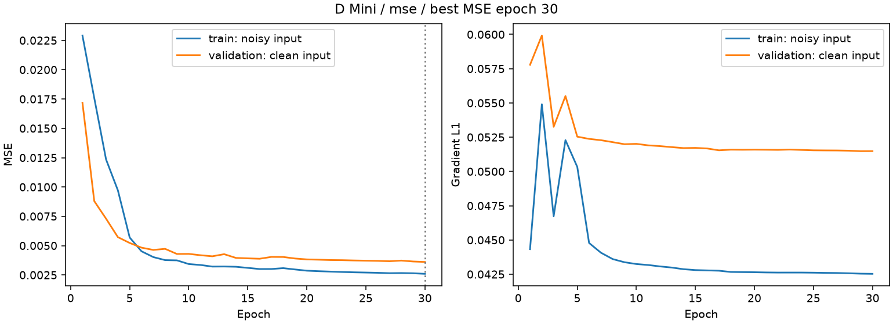
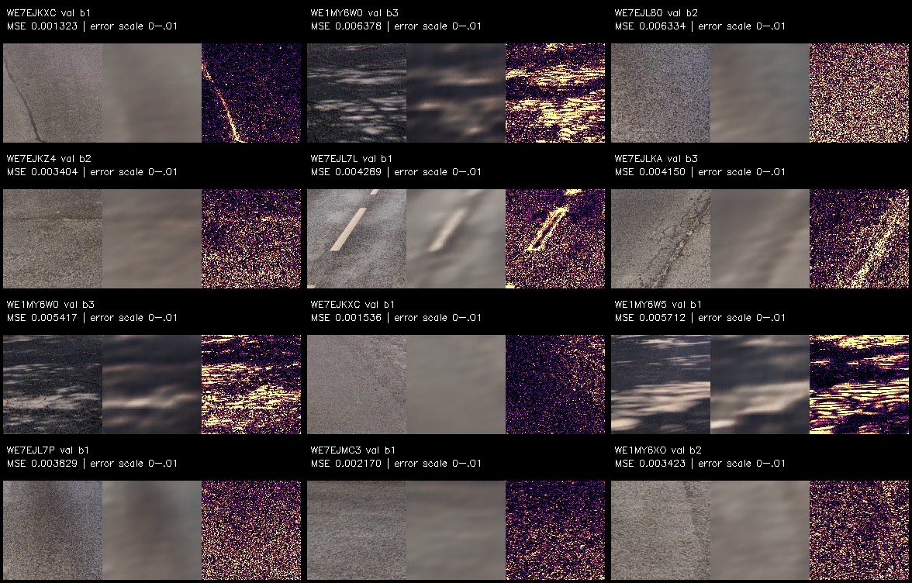
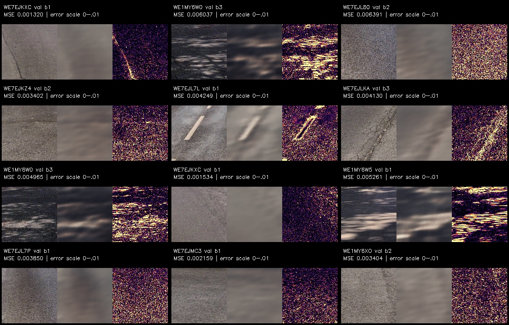
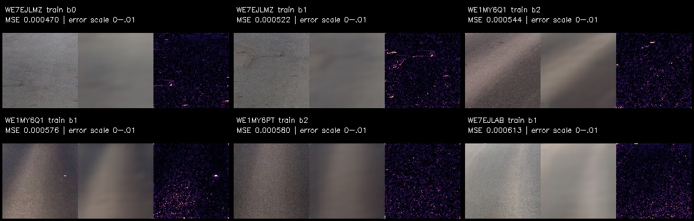
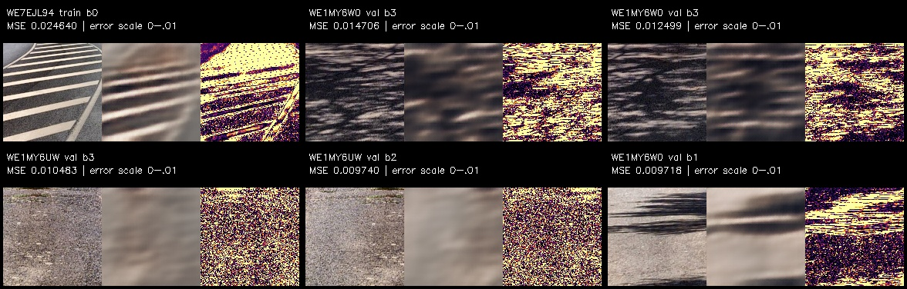

# B–E: dokumentierte Mini- und Stage-2-Ergebnisse

**Code-Nachtrag 18.09.2026:** B bereitet jetzt über `preprocess_for_segmentation` die unveränderte RGB-Ansicht für C vor und verwaltet die Maskenabbildung. Die historische D-Arbeitsansicht bleibt pixelgleich vorgesehen; der Vorher-nachher-Test ist noch auszuführen. Die Filterroutine unterstützt jetzt drei Bilder, die neue Grafik ist noch zu erzeugen. Frühere Messwerte unten wurden nicht neu berechnet.

Dokumentation nach abgeschlossenem Stage-2-Lauf (Arbeitsstand September 2026).
**Für die gemeinsame Durchsicht: [Stage-2-Ergebnisse mit Bildern und Rangliste](results/README.md).**

Grundlage: Assignment „A Road-Condition Analysis Pipeline from Unlabeled
Street-Level Imagery“, insbesondere D (Seite 9) und E (Seite 10).
Frühere Berichtsfassungen mit anderen Datenzahlen, Maskenmethoden und
Modellwerten sind keine Belege für den aktuellen Stand.

## 1. Ziel des Assignments

Rekonstruktionsfehler sollen visuell ungewöhnliche Straßenflächen hervorheben.
Sie sind keine Schadenswahrscheinlichkeiten oder fachlich kalibrierten
Zustandsnoten. Risse, Reparaturstellen, Schatten, Fremdkörper und seltene Beläge
können gleichermaßen auffällig sein.

Stage 1 prüft ausdrücklich zunächst die technische Kette auf ungefähr 100 Bildern:
Patch-Extraktion, Forward/Backward-Pass, Training und Fehlerberechnung. Ein bereits
nützliches Zustandsmodell ist hier noch nicht das Ziel. Für die endgültige
D-Abgabe werden Stage-2-Checkpoint, dessen Trainings-/Validierungskurve und
Original-/Rekonstruktionsvergleiche einschließlich guter/schlechter Mini-Beispiele
verlangt. E(a) verlangt das Ranking der **Mini-Bilder mit dem Stage-2-Modell**;
weitere Pool-Inferenz ist Bonus. E(b) verlangt qualitative Interpretation,
E(c) einen konkreten Validierungsvorschlag und E(d) fachliches Feedback anhand
verständlicher Darstellungen. Keine dieser Anforderungen belegt automatisch
zuverlässige Schadenserkennung.

## 2. Tatsächlicher Bestand und Nachweise

| Bestand / Nachweis | Stand |
|---|---|
| Mini | 108 vorhandene Bilder unter `data/mini` |
| Großer lokaler Bestand | 1.765 Bilder unter `data/26-07-13-Cyclomedia-Test-Hammersbach` |
| Metadaten | 12.432 Einträge; keine 12.432 lokal vorhandenen Bilddateien |
| Mini im großen Bestand | Alle 108 enthalten; Inventory mit Byte-Identitätsprüfung erfolgreich ausgeführt |
| C-Mini-Lauf | Nutzerprotokoll: 108 erfolgreich, keine Ausführungsfehler, 338,1 s |
| C-Statusdateien | 107 `ok`, 1 `review`; keine manuelle Ground Truth |
| C-Tests | Nutzerprotokoll: 10 bestanden, eine Pytest-Sammelwarnung |
| D-v2-Tests vor Stage-2-Erweiterung | Nutzerprotokoll: 17 bestanden |
| D-Mini-Training | Zwei vom Nutzer ausgeführte CPU-Läufe, jeweils 30 Epochen |
| Tests einschließlich Stage 2 | Nutzerprotokoll: 22 bestanden in 12,88 s |
| Pool-C | 1.765 verarbeitet, 0 Ausführungsfehler; 1.754 ok, 9 review, 2 no_road |
| Stage-2-Training | 30 Epochen auf CPU, ungefähr 4 h laut Nutzer, beste Epoche 29 |
| Stage-2-Mini-Analyse | 108 Bilder / 996 Patches ausgewertet |

Die Differenz zum ungefähr 10.000 Bilder umfassenden Assignment-Pool wird
offengelegt. Fehlende Dateien werden nicht als Trainingsbilder gezählt.
`d_stage2 inventory` protokolliert fehlende IDs, PyTorch-Version und verfügbare
CUDA-Hardware. CUDA war laut Inventory nicht verfügbar. Das Training wurde auf CPU ausgeführt; Dauer ungefähr vier Stunden.

## 3. B: Vorverarbeitung

Die aktuelle B-Funktion schneidet vertikal 40–80 % aus, skaliert bei erhaltenem
Seitenverhältnis auf 2048 Pixel Breite und wendet CLAHE auf den Helligkeitskanal an.
Aus 8192×6144 werden 2048×614 Pixel. Dieser breite B-Zuschnitt allein garantiert
keine vollständige Haubenentfernung. C verwendet daher einen eigenen
konservativeren Zuschnitt; D entnimmt nur vollständig von C maskierte Flächen.

Eine metrische Perspektivkorrektur wird nicht angewendet. Vier Tiefenbänder
streuen Patchpositionen, gleichen reale Maßstabsunterschiede aber nicht vollständig
aus. 128×128 Arbeitsbildpixel entsprechen nicht 128×128 Originalpixeln. Durch
Verkleinerung können sehr feine Schäden schlechter sichtbar werden.

B-Code wurde in dieser Vorbereitung nicht geändert. Die B-Abgabe verlangt
Fourier-/Filterdarstellungen für mindestens drei Bilder. Die historischen
Darstellungen wurden in dieser Arbeitsphase nicht erneut vollständig überprüft;
vor Abgabe sind sie mit der beschriebenen B-Version abzugleichen.

## 4. C: akzeptierte Straßenerkennung

Die MobileSAM-Logik aus dem früheren Testprojekt ist im Hauptprojekt integriert.
C nutzt RGB ohne CLAHE, vertikal 45–73 % und höchstens 1024 Pixel Inferenzbreite.
Fünf positive Punktvarianten im unteren Bereich und negative Hinweise in grünen
Randbereichen erzeugen Kandidaten. Konfidenz, Lage, Zusammenhang, Vegetation und
Textur gehen in die Auswahl ein. Kein Fine-Tuning. Details und Dateipfade:
[docs/ARCHITEKTUR.md](ARCHITEKTUR.md) (§3.2).

Die Maske wird über Originalkoordinaten mit nächster-Nachbar-Abbildung auf B
übertragen; nicht untersuchte Bereiche bleiben leer. Python liefert boolesche
Masken, PNGs speichern 0/255. Sidecars prüfen Quelle, Maskeninhalt und Konfiguration.
Der Nutzer hat die erzeugten Masken als zufriedenstellend beurteilt.

`WE1MY5SL` hat Status `review` und Konfidenz 0,8382. Dies ist ein automatischer
Prüfhinweis, kein bewiesener Segmentierungsfehler. Für die Abgabe ist ein
tatsächlich visuell unpräziser Fall mit Overlay zu erläutern. Der Status allein
erfüllt diese qualitative Anforderung nicht. Schatten, Randvegetation und
abweichende Straßenführung bleiben mögliche Ursachen.

## 5. D: Patches, Split, Modell und Annahmen

Der aktuelle Mini-Bestand liegt unter `outputs/d_v2`. Höchstens 24 Patches je
Bild, mindestens 64 Pixel Mittelpunktabstand, vier Tiefenbänder und Seed 42.
Quadratische Erosion plus Prüfung jeder 128×128-Fläche sichert vollständige
geometrische Maskenabdeckung. Überlappungen bleiben möglich; die Patches sind
keine unabhängigen Bildaufnahmen.

Der Grünfilter verwirft deutliche Vegetationshinweise, nicht bloß braune Flächen.
Im aktuellen Mini-Lauf wurden **keine** Kandidaten durch diesen Filter verworfen.
Eine fehlende `patches_rejected.jpg` ist deshalb korrekt. Alle 108 Bilder liefern
Patches; die geprüfte Auswahlübersicht zeigt überwiegend plausible Straßenflächen.
Dies ist keine manuelle Einzelprüfung aller 996 Patches.

| Split | Bilder | Patches |
|---|---:|---:|
| Training | 77 | 672 |
| Validierung | 26 | 282 |
| Räumlicher Puffer | 5 | 42 |
| Gesamt | 108 | 996 |

Die Aufteilung erfolgt vor Patch-Erzeugung über 300-m-Zellen, gleiche
Dateiprüfsummen und einen 30-m-Puffer zwischen Training und Validierung.
Pufferbilder zählen nicht zu Training oder Modellselektion. Visuell ähnliche
Dateien ohne identische Bytes und weitere räumliche Abhängigkeiten können damit
nicht vollständig ausgeschlossen werden.

Conv-Autoencoder: 1.078.307 Parameter, Encoderkanäle 32/64/128/256, räumlicher
Engpass 256×8×8, transponierte Faltungen im Decoder, Sigmoid, keine Skip-Verbindungen.
BGR-Kanäle werden konsistent verwendet; MSE gewichtet alle drei Kanäle gleich.
Die Architektur ist lokal trainierbar, im Verhältnis zu 672 Trainingspatches
aber weiterhin groß. Überanpassung bleibt möglich.

Adam, Lernrate 0,001, Batchgröße 64, Seed 42, Eingangsrauschen σ=0,02, maximal
30 Epochen. Rekonstruktionsziel sind saubere Patches. Auswahl nach sauberem
Validierungs-MSE; Early Stopping nach fünf Epochen ohne Verbesserung und
Halbierung der Lernrate nach zwei Plateau-Epochen.

„Überwiegend normale Straße“ ist eine Annahme. Masken und Grünfilter garantieren
keine Schadensfreiheit. Training enthält potenziell Schäden, Schatten und
Markierungen. Werden häufige Schäden mitgelernt, können sie unauffällig werden.

## 6. Beobachtete Mini-Ergebnisse

| Lauf | Beste Epoche | Train-MSE, sauber | Val-MSE, sauber | Val-Kantenfehler | Puffer-MSE |
|---|---:|---:|---:|---:|---:|
| MSE | 30 | 0,00257160 | 0,00360874 | 0,05148291 | 0,00331208 |
| MSE + 0,1 × Kantenverlust | 30 | 0,00253708 | 0,00356167 | 0,05123176 | 0,00333077 |

Quelle: gespeicherte `metrics.json`. Die sauberen Trainingswerte unterscheiden
sich von den Trainingswerten mit verrauschtem Eingang in `history.csv`. Beide
Läufe teilen Patchmanifest und dieselben zwölf Validierungsbeispiele. Beste
Epoche ist jeweils die letzte; vollständige Konvergenz ist nicht nachgewiesen.

Der Kantenverlust senkt den Validierungs-MSE um etwa 1,30 %, den Kantenfehler um
0,49 %. Der Puffer-MSE wird leicht schlechter. Ein einzelner Seed und dieser
kleine Unterschied belegen keinen belastbaren Vorteil.

Die Abbildungen sind unveränderte Kopien unter `docs/results/stage1` und werden
mit der Dokumentation versioniert. Es wurden keine Rekonstruktionen neu berechnet.

Qualitativ erhalten beide Modelle Helligkeitsverläufe und grobe Formen, glätten
aber feine Asphaltkörnung. Der Kantenverlust ändert das kaum sichtbar. Bei
`WE7EJKXC` verschwindet ein schmaler Riss weitgehend trotz vergleichsweise
niedrigem Patch-MSE: Ein lokaler Fehler erhält im Pixelmittel wenig Gewicht.
Markierungen bei `WE7EJL94` und Schatten bei `WE1MY6W0` gehören zu den größten
Fehlern. Raue Oberfläche bei `WE1MY6UW` ist ebenfalls auffällig, ohne damit
fachlich als Schaden bestätigt zu sein. Gleichmäßige dunkle Flächen werden
oft gut rekonstruiert; ein niedriger MSE beweist keine Schadensfreiheit.
Beste/schlechteste Übersichten enthalten verschiedene Splits, sichtbar beschriftet.

Stage 1 erfüllt seinen technischen Zweck, belegt aber keinen zuverlässigen
Schadensdetektor. Für Stage 2 wird die einfachere MSE-Basis beibehalten. Weitere
Mini-Optimierung ist keine Voraussetzung des Assignments.

## 7. E: ausgeführte Stage-2-Analyse und Grenzen

Die primäre Stage-2-Analyse ist der lokale Pool-Lauf mit `aibip.pool` (Adapter
`portable_pool`, Ausführung nur aus dem Projekt-Root). Das beste Modell stammt
aus Epoche 29 mit Validierungs-MSE 0,000905 (`metrics.json` der Stage-2-Run-
Ordners). Die Extraktion umfasst 109.415 uint8-Patches aus 12.281 von 12.432
Pool-Bildern; 151 Bilder liefern keine geometrisch geeigneten Patches. Das
Bildsignal ist der **Median** der Patch-MSE je Bild (robust gegen Einzel-
Ausreißer); Bilder mit weniger als vier bewertbaren Patches erhalten das
Flag `low_support` und gelten nur als Review-Fall, nicht als verlässlicher
Rang.

Die Mini-Auswertung läuft über denselben Befehl mit `--sample-dir data/mini`.
Das Mini-Set umfasst exakt 100 Bilder (`config.N_MINI = 100`, deterministisch
gezogen, materialisiert in `data/mini`). Alle 100 Bilder haben Werte, aus
insgesamt 935 Patches; 82 gehören zum Training, 15 zur Validierung, 3 zum
Puffer. Mini ist daher kein unabhängiger Testbestand. Vollständige Ranglisten,
QC-Bilder und `analysis.json` liegen unter `outputs/pool/runs/mse/stage2/`
(`pool_analysis/` für den ganzen Pool, `sample_analysis/` für Mini).

Historische Provenienz: Vor dem Pool-Adapter wurde derselbe Analysegang mit
`aibip.d_stage2` auf einem 1.765-Bilder-Ordner ausgeführt (damals 108 Mini-
Bilder, 996 Patches, Validierungs-MSE 0,001828788). Die damaligen 108 Mini-
Bilder stammen aus einem älteren, kleineren Mini-Schnitt; der aktuelle Stand
ist der deterministische 100er-Satz nach `config.N_MINI`. Ergebnisse jenes
Laufs: [Stage-2-Ergebnisse](results/README.md). Das historische `aibip.part_e`
liest andere Modellpfade und ist nicht die Quelle beider Analysen.

**E(b), beobachtet (lokaler Lauf, Mini-Ranking):** Die zehn auffälligsten
Bilder wurden anhand der QC-Bögen und Originalszenen gesichtet und in
`sample_analysis/manual_review.csv` als Agent-Vorbefund dokumentiert (manuell
zu bestätigen). Das Bild mit dem höchsten Wert, `WE1MY6UW`, ist ein schmaler
Splittweg mit grobkörniger, fleckiger Oberfläche und nur zwei bewertbaren
Patches (`low_support`). Dasselbe Muster zeigt `WE1MY5K0` und `WE1MY62K`
(helle sandig-kiesige wassergebundene Decke). Auf glattem Asphalt stehen
dagegen Verschleiß-/Texturmuster im Vordergrund: `WE7EJL7P`, `WE7EJL7L` und
`WE7EJL80` (feinkörniger, glänzender Belag mit krautigem Bankett), `WE7EJL6Y`
(dunkle Flickstelle), `WE1MY5SW` (fleckiger Wohnstraßenbelag mit Parkern und
Pflasterkanten). Schatten wirkt als zweiter Faktor: `WE7EJL6V` (Baum-
schattenkanten), `WE7EJL8J` (sonnenbeschienener frischer Asphalt mit
Überstrahlung), `WE1MY5SW` (tiefe Abendsonne). Die typischsten Bilder sind
glatter Asphalt; Schatten- und Markierungspatches (z. B. `WE1MY6W5`,
`WE7EJL9Q`) werden dort sauber rekonstruiert. Die Kernfrage bleibt also
offen, aber gerichtet: Das Signal korreliert in diesem Vorbefund klar mit
**Oberflächentyp** (Körnung, wassergebundene Decke, Flickstellen), weniger
mit Schatten oder Markierungen — und bislang nicht belegt mit experten-
relevanter Schadensauffälligkeit. Hohe Werte zeigen visuelle Ungewöhnlichkeit,
keine Schadensdiagnose.

**E(c), Validierungsvorschlag:** Etwa 30 Beispiele aus hohen, mittleren und
niedrigen Rangbereichen des Pool-Rankings im Originalkontext durchsehen.
Sichtbare Schäden, offenbar intakte Oberfläche, Oberflächentypen, Markierungen,
Schatten und unklare Fälle getrennt notieren, möglichst fachkundig und
zunächst ohne eingeblendeten Rang. Danach prüfen, ob Schäden unter hohen
Werten häufiger auftreten und welche Störfaktoren — nach E(b)-Vorbefund
vor allem Oberflächentyp — Fehlalarme erklären. Eine zur Modellauswahl
verwendete Auswahl ist anschließend kein unabhängiger Test. Diese Annotation
ist vorgeschlagen, noch nicht durchgeführt.

**E(d), Expertenfeedback:** Original/Straßenausschnitt, C-Overlay, Patchposition,
Original/Rekonstruktion und gemeinsame Fehlerkarte zeigen. Dazu Bildwert
(Median-MSE), Patchzahl, `low_support`-Flag und Split sowie Raum für
„Schaden“, „Schatten/Markierung“, „Oberflächentyp“, „Maskenfehler“ und
„unklar“. Das Modell priorisiert Sichtungen; die Fachperson beurteilt die
Relevanz. Ein MSE allein erklärt keine Ursache.

## 8. Stage 2 abgeschlossen; verbleibende Abgabe

Anleitung: [Anleitung.md](../Anleitung.md). Der lokale Lauf verwendet den vollständigen
12.432-Bilder-Pool nach `config.POOL_DIR` (Adapter `portable_pool`); C-Code
blieb unverändert. Der räumliche Split wird auf dem ganzen Pool gebildet
(80.678/23.909/4.828 Patches für Training/Validierung/Puffer); die Zugehörigkeit
einzelner Mini-Bilder kann sich dadurch gegenüber Stage 1 ändern. Mini ist
deshalb kein grundsätzlich unabhängiger Testbestand nach Stage 2.

Bildweise gespeicherte uint8-Chunks erlauben Wiederaufnahme und Neuaufbau der
Extraktion ohne erneute Segmentierung; der Shard wird speicherschonend
zusammengesetzt und batchweise gelesen. Dies wurde im Projektverlauf praktisch
genutzt: Nach einer Sidecar-Regenerierung wurde der Patch-Bestand aus den
unveränderten Masken neu aufgebaut und per SHA-256 byteidentisch zum
Trainingszeitpunkt verifiziert (`903cb3ca…`), sodass Checkpoint und Index ohne
Retraining gültig blieben. Die gemeinsame Architektur/Trainingsschleife wird
mit frischen Gewichten gestartet; nur `--resume` setzt einen begonnenen
Stage-2-Lauf fort.

Der technische Stage-2-Lauf ist abgeschlossen: 109.415 Patches aus 12.281 von
12.432 Bildern, bestes Modell aus Epoche 29 mit Validierungs-MSE 0,000905.
Das Pool-Ranking (12.432 Bilder, Signal: Median-Patch-MSE) liegt in
`outputs/pool/runs/mse/stage2/pool_analysis/`, die Mini-Auswertung in
`sample_analysis/`. Tatsächliche Kennzahlen und Quellen stehen in
[docs/results](results/README.md).

**Bonus — Skalierung:** Das Ranking hält auf allen 12.432 Pool-Bildern durch:
12.017 Bilder sind bewertet (`scored`), 264 als `low_support` markiert und 151
liefern keine Patches. Die Verteilung ist deutlich rechtsschief: Der Median
der Bildsignale liegt bei 0,000620, das 99-Perzentil bei 0,004471 — rund
Faktor 7,2. Die zehn auffälligsten Bilder sind räumlich geclustert
(`WE1MY3X8`/`WE1MY3X9` sowie eine `WE1MY4xx`-Serie: `WE1MY4RD`, `WE1MY4RC`,
`WE1MY4RF`, `WE1MY4KA`, `WE1MY4X3`, `WE1MY4FC`, dazu `WE1MY2Y5`, `WE1MY2XT`);
es handelt sich offenbar um zusammenhängende Belagsabschnitte, nicht um
verteilte Einzelfälle. Das unauffälligste Ende wird von glatten, uniformen
Patches dominiert (`WE1MY338`, 21 Patches, Median 0,000029). Der Vergleich
mit dem älteren, mean-basierten Ranking (`pool_analysis_v1_mean/`) zeigt eine
7/10-Überschneidung der Top-10 — das Median-Signal stabilisiert also das
Einzelbild-Urteil, ändert die Spitze aber kaum. Fazit: Das Ranking skaliert
auf den vollen Pool; die Aussagekraft bleibt begrenzt auf Oberflächen-
Heterogenität mit räumlichem clusterndem Verhalten — es ist ein stabiles
Review-Signal, keine Schadenswahrscheinlichkeit.

Vor der endgültigen Abgabe noch offen: B-Abbildungen gegen die aktuelle Version
prüfen und einen tatsächlich unpräzisen C-Fall mit Overlay erläutern. E(b)
liegt als Agent-Vorbefund in `sample_analysis/manual_review.csv` vor und wartet
auf die manuelle Bestätigung; E(c)/(d) sind als Strategie dokumentiert, eine
Expertenstudie wurde nicht durchgeführt. Gewichte und große Daten bleiben
außerhalb des Git-Ergebnisberichts und sind für die Abgabe separat
bereitzustellen. Die geteilten Abbildungen und Tabellen sind ohne diese
Dateien lesbar.
