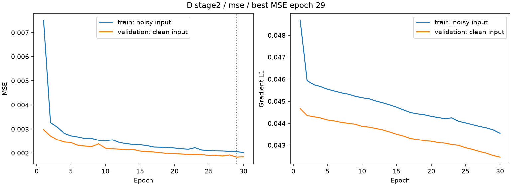
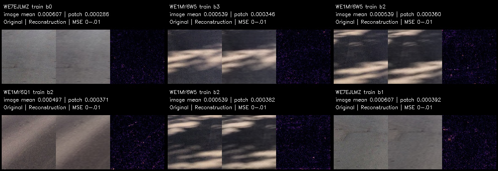
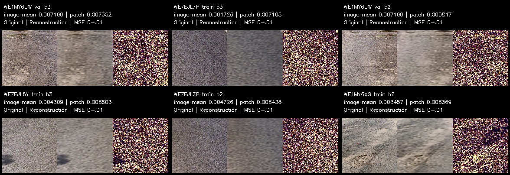

# Ergebnisse: Stage 2 und Mini-Auswertung

Diese Seite ist der Einstieg für die gemeinsame Durchsicht im Repository.
Alle eingebetteten Bilder und verlinkten Tabellen liegen unter `docs/results`.
Zum Ansehen sind weder Bilddatensatz noch Python, Modellgewichte oder ein erneutes
Training erforderlich. Die Dateien müssen zusammen mit dieser Seite committed
und gepusht werden. Methodik und weitere Abgabeanforderungen: [Bericht](../report.md).

## Was tatsächlich ausgeführt wurde

Tests und Pipeline wurden lokal ausgeführt. Die folgende Dokumentation
basiert auf den gespeicherten Ergebnisdateien und den Konsolenausgaben.
Es wurden für diese Dokumentation keine neuen Modellrechnungen durchgeführt.

| Schritt | Ergebnis |
|---|---|
| Tests für D v2 und Stage 2 | 22 bestanden in 12,88 s laut Nutzerprotokoll |
| Inventory | 1.765 Bilddateien, 108 Mini-Bilder; 10.667 Metadaten-IDs ohne Bilddatei |
| Gerät | CUDA nicht verfügbar; Training auf CPU |
| Pool-Segmentierung C | 1.765 erfolgreich verarbeitet, 0 Ausführungsfehler, 108 Caches wiederverwendet |
| C-Status | 1.754 `ok`, 9 `review`, 2 `no_road`; keine manuelle Qualitätsbewertung |
| Segmentierungslaufzeit | 8.211,1 s laut Konsole, etwa 2 h 17 min |
| Pool-Extraktion D | 15.155 Patches aus 1.758 von 1.765 Bildern |
| Stage-2-Training | 30 Epochen, ungefähr 4 Stunden (Nutzerangabe) |
| Modellselektion | Beste Epoche 29, Validierungs-MSE 0,001828788 |
| Mini-Inferenz mit Stage-2-Modell | Alle 108 Bilder bewertet, insgesamt 996 Patches |

Der vorhandene Bestand ist kleiner als der ungefähr 10.000 Bilder umfassende
Assignment-Pool. 12.432 Metadateneinträge werden nicht als vorhandene Bilder
ausgegeben. Die vier Stunden sind eine Nutzerangabe, keine aus Log-Zeitstempeln
rekonstruierte Messung.

## Datenaufteilung und Training

| Pool-Split | Bilder vor Extraktion | Bilder mit Patches | Patches |
|---|---:|---:|---:|
| Training | 1.265 | 1.259 | 10.683 |
| Validierung | 433 | 432 | 3.833 |
| Räumlicher Puffer | 67 | 67 | 639 |
| Gesamt | 1.765 | 1.758 | 15.155 |

Der räumliche Split wird vor der Patch-Erzeugung bestimmt: 300-m-Zellen, gleiche
Dateiprüfsummen zusammenhalten, 30-m-Puffer zwischen Training und Validierung.
Pufferbilder werden nicht trainiert oder zur Modellselektion verwendet.

Sieben Bilder liefern keine passenden 128×128-Patchpositionen (`no_geometry`):
`WE1MY5S6`, `WE1MY5SI`, `WE1MY662`, `WE1MY6UK`, `WE7EJL3B`, `WE7EJLL4`,
`WE7EJM16`. Zwei davon haben bereits C-Status `no_road`; bei den anderen reicht
die geometrisch geeignete Straßenfläche für den Sampler nicht aus. Zusätzlich
wurden sechs Kandidaten durch den Grünfilter verworfen.
[Vollständiges Extraktionsaudit](stage2/extraction_audit.json).

Die Architektur entspricht dem Mini-Test: Conv-Autoencoder mit 1.078.307
Parametern, Encoder 32/64/128/256 Kanäle, räumlicher Engpass 256×8×8,
Sigmoid-Ausgabe, keine Skip-Verbindungen. Frische Initialisierung für Stage 2.
128×128-Patches stammen aus dem 2048 Pixel breiten Arbeitsbild, mit CLAHE;
höchstens 24 je Bild, mindestens 64 Pixel Mittelpunktabstand, vier Tiefenbänder.
MSE, Adam 0,001, Batch 64, Seed 42 und Eingangsrauschen σ=0,02. Das Training
verwendet die Annahme überwiegend normaler Straße, keine geprüften Normal-Labels.

Die Verluste sinken insgesamt, mit einzelnen Schwankungen. Epoche 29 hat den
kleinsten Validierungs-MSE; Epoche 30 ist etwas schlechter. Early Stopping wurde
nicht ausgelöst, die Grenze von 30 Epochen wurde erreicht. Die Kurve zeigt weder
vollständige Konvergenz noch einen Nachweis fachlicher Schadenserkennung.
Trainingswerte in der Kurve stammen von verrauschten Eingaben, Validierungswerte
von sauberen Eingaben. Verschiedene Splits sind außerdem verschieden zusammengesetzt.

Saubere Rekonstruktionsfehler des **erneut geladenen besten Checkpoints**:

| Split | MSE | Mittlerer Kantenfehler |
|---|---:|---:|
| Training | 0,001982203 | 0,043506721 |
| Validierung | 0,001828788 | 0,042532532 |
| Puffer | 0,002482111 | 0,048127561 |

Die Kantenkennzahl dient hier der Auswertung; der Stage-2-Lauf verwendet nur MSE
als Trainingsverlust. Quellen: [Metriken](stage2/metrics.json),
[alle 30 Epochen als CSV](stage2/history.csv).
Der Validierungs-MSE ist nicht direkt mit Stage 1 vergleichbar, da Bildbestand
und Validierungssplit geändert wurden. Eine prozentuale Verbesserung der
Schadenserkennung lässt sich daraus nicht ableiten.

## Mini-Ranking: so sind die Bilder zu lesen

Jede Kachel zeigt **Original | Rekonstruktion | Fehlerkarte**.
Die Farbskala ist in allen Übersichten dieselbe: mittlerer quadratischer
Farbkanalfehler pro Pixel von 0 bis 0,01; höhere Werte sättigen.
Helle Pixel bedeuten große Abweichungen, keine Schadenswahrscheinlichkeit.

Der **Bildrang** basiert auf dem Mittelwert aller gültigen Patchfehler eines
Bildes. Die Kachel zeigt jeweils dessen **fehlerstärksten Patch**. Daher sind
`image mean` und `patch` unterschiedliche Zahlen. Ein einzelner Ausschnitt ist
nicht die vollständige Erklärung des Bildmittelwerts.

**Mini ist kein unabhängiger Testbestand:** 83 Bilder gehören zum Stage-2-Training,
22 zur Validierung und 3 zum Puffer. Alle sechs gezeigten typischsten Bilder
stammen aus dem Training. Bei den sechs auffälligsten sind fünf im Training,
eines in der Validierung. Die Labels sind auf den Kacheln sichtbar.

### Typischste Bilder

`WE1MY6Q1` hat den niedrigsten Bildmittelwert (0,000496554, fünf Patches).
Die Beispiele zeigen meist relativ gleichmäßige Oberflächen. Das Modell
rekonstruiert bei `WE1MY6W5` auch Schattenverläufe und bei `WE7EJL9Q` eine
Fahrbahnmarkierung. Solche Inhalte erzeugen daher nicht zwangsläufig einen
hohen Bildwert. Sichtbare feine Strukturen bleiben teilweise geglättet.
Ein niedriger Rang beweist keine Schadensfreiheit.

### Auffälligste Bilder

`WE1MY6UW` hat den höchsten Bildmittelwert (0,007099531, Validierung), gefolgt
von `WE7EJL7P` (0,004725983, Training). Viele gezeigte Ausschnitte haben
ausgeprägte Körnung beziehungsweise eine ungleichmäßige Oberflächenstruktur.
Die Rekonstruktion bildet deren genaue Anordnung schlecht ab; die Fehlerkarte
ist dadurch großflächig hell. Das Signal reagiert in diesen Beispielen stark
auf Textur und nicht ausschließlich auf isolierte Risse.

Bei `WE1MY6UW` sind zudem ein bewachsener Rand und eine ungleichmäßige Oberfläche
sichtbar. Eine eindeutige Schadensdiagnose ist aus dem Ausschnitt nicht möglich.
**Das Bild wird nur durch zwei Patches repräsentiert.** Sein hoher Mittelwert
beschreibt diese kleine Stichprobe; er ist keine umfassende Bewertung der Straße.
Die anderen Rangenden beruhen teilweise auf deutlich mehr Patches.

[Vollständige Rangliste aller 108 Bilder](stage2/ranking.csv) enthält Rang,
Split, Patchzahl sowie Mittel-/Maximalfehler. Rang 1 ist am typischsten, Rang 108
am auffälligsten. [Einzelpatchwerte und Positionen](stage2/patch_scores.csv).

## Beste und schlechteste Einzelpatches

Diese Auswahl wird über alle 996 Mini-Patches getroffen, unabhängig vom Bildrang.
Mehrere Kacheln dürfen deshalb aus demselben Bild stammen.

Glatte Helligkeitsverläufe und manche Schatten werden gut nachgebildet.
Stark strukturierte Oberflächen gehören häufig zu den größten Fehlern.
Auch die guten Rekonstruktionen sind keine pixelgetreuen Kopien der Asphaltkörnung.
Diese Beispiele zeigen Fähigkeiten und Grenzen des Modells, keine gelabelten
Treffer beziehungsweise Fehlklassifikationen.

## Schlussfolgerung für D und E

D wurde auf dem vorhandenen größeren Bestand trainiert; Checkpoint, Lernkurve
und die verlangten Mini-Rekonstruktionen liegen vor. E(a) wurde mit diesem
Stage-2-Modell ausgeführt. Für E(b) zeigen die vorliegenden Beispiele insbesondere
Oberflächentextur als Einflussfaktor. Schatten und Markierungen sind weiterhin
mögliche Störfaktoren, werden in einigen gezeigten Fällen aber gut rekonstruiert.
Ein zuverlässiger Schadensklassifikator oder ein Vergleich mit Expertennoten
wurde nicht nachgewiesen.

Der Vorschlag für eine kleine manuell bewertete Teilmenge und die Einbindung
von Fachpersonen sind in [Bericht, E(c)/(d)](../report.md) dokumentiert.
Eine entsprechende Annotation oder Expertenstudie wurde nicht durchgeführt.
Vor der endgültigen Abgabe sind außerdem B-Abbildungen und ein tatsächlich
unpräziser C-Fall zu prüfen; das ist unabhängig vom abgeschlossenen D-Training.

## Nachvollziehbarkeit und gemeinsame Durchsicht

- [Analyse-Metadaten](stage2/analysis.json): Checkpoint-/Patchmanifest-Prüfsummen,
  Epoche, Anzahl und Auswahl der gezeigten Patches.
- [Kopiernachweis](provenance.json): relative Quell-/Zielpfade und SHA-256 aller
  übernommenen Ergebnisdateien. Die Kopien sind unverändert.
- Das lokal vorhandene `outputs/d_stage2/runs/mse/stage2/best.pt` wurde anhand
  seiner SHA-256 gegen die Metriken geprüft. Gewichte und großer Patchbestand
  sind nicht Teil dieser Ansichtsdokumentation; sie bleiben unter `outputs/`.
  Für die Abgabe oder erneute Inferenz den Checkpoint separat bereitstellen.
- Die [Anleitung](../../Anleitung.md) beschreibt die Reproduktion. Zum bloßen
  Durchsehen dieser Ergebnisse genügt diese Seite im Repository.
- Ältere Mini-Vergleiche sind im [Bericht](../report.md) als Stage 1 gekennzeichnet.
  Das historische `aibip.part_e` liest andere Ergebnisse und ist nicht die Quelle
  dieser Stage-2-Analyse.

Für die gemeinsame Besprechung: Sind die auffälligen Oberflächen tatsächlich
fachlich interessant, oder vor allem grobkörnig? Welche Ausschnitte benötigen
mehr Originalkontext? Sind zwei Patches bei `WE1MY6UW` für eine Beurteilung genug?
Diese Fragen bleiben bewusst offen, statt Bildfehler als Schadenslabels auszugeben.
